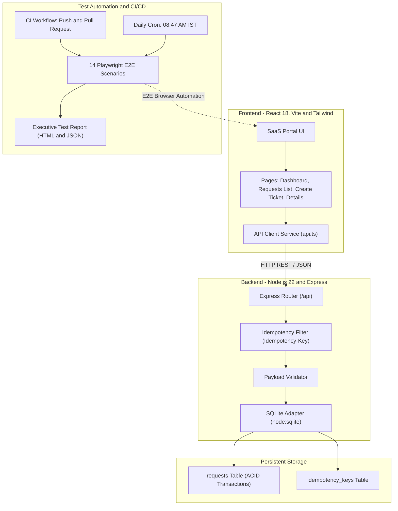

# Property Management Service Request Portal 🏢
### Enterprise Incident & Maintenance Request Lifecycle Automation

[](https://github.com/menaka1703/service-request-automation-demo/actions/workflows/ci.yml)
[](https://github.com/menaka1703/service-request-automation-demo/actions/workflows/daily-regression.yml)

A modern, production-grade **Property Management Service Request Management System** built with React 18, Vite, TypeScript, Tailwind CSS, Express, native SQLite, Playwright end-to-end automation, and GitHub Actions CI/CD scheduling.

Designed specifically for enterprise demonstrations, featuring modern SaaS UI/UX, structured property and resident metadata, idempotency-protected ticket submissions, deterministic database state management, and an automated regression test suite.

---

## 🌟 Key Highlights & Features

- **Modern Enterprise SaaS UI**:
  - Pinned sidebar navigation with responsive layout.
  - Operations Dashboard with KPI metric cards, status distribution, priority urgency breakdown, and top workload categories.
  - Interactive status chips (`All`, `Open`, `In Progress`, `Completed`, `Closed`) with instant count badges.
  - Clean data tables with status and priority badges, eliminating duplicate dropdowns.
- **Dedicated Property Management Ticket Intake**:
  - Structured property metadata: Unit / Apartment number, Building / Block, Floor level.
  - Resident contact details, unattended entry permission indicator, and preferred visit window.
  - 12 comprehensive Property Management service categories (Plumbing, Electrical, HVAC, Maintenance & Repairs, Pest Control, Cleaning, Security & Access, Landscaping, Parking, Lease & Tenancy, Move In / Move Out, Common Areas).
  - Triage turnaround targets: Urgent (&lt; 4 Hours), High (&lt; 24 Hours), Medium (&lt; 48 Hours), Low (&lt; 5 Days).
- **Service Request Details & Lifecycle Management**:
  - Dedicated cards for Property & Location, Resident & Access Permissions, and SLA Targets.
  - Interactive one-click lifecycle state transitions (`Open` → `In Progress` → `Completed` → `Closed`).
  - In-place ticket editing and destructive confirmation modal before deletion.
- **Duplicate Submission Guard**:
  - Internal backend `Idempotency-Key` duplicate detection and cached replay to eliminate double-clicks and network resubmissions.
- **Zero-Dependency SQLite Persistence**:
  - High-performance local persistence using Node.js native `node:sqlite` engine with automated migrations, schema indexing, and sample dataset seeding.
- **Playwright Test Matrix (14 Scenarios across 11 Test Suites)**:
  - 100% automated regression coverage running against an isolated test database with HTML reporting, screenshots, and failure traces.
- **GitHub Actions Automation**:
  - **CI Workflow (`ci.yml`)**: Automated builds and test validation on every push and pull request.
  - **Daily Regression Scheduler (`daily-regression.yml`)**: Scheduled daily at **08:47 AM IST** (03:17 UTC) via cron with manual `workflow_dispatch` support, test database isolation, and failure artifact retention.

---

## 🏛️ System Architecture



---

## 💻 Tech Stack

| Layer | Technology | Description |
| :--- | :--- | :--- |
| **Frontend** | React 18, TypeScript, Vite | Fast HMR, type safety, modular component hierarchy |
| **Styling** | Tailwind CSS 3, Lucide Icons | Responsive enterprise styling, polished animations, pinned sidebar |
| **Backend** | Node.js 22, Express | RESTful API, structured error handling, CORS enabled |
| **Database** | SQLite (`node:sqlite`) | Zero-configuration native ACID engine, indexed schema |
| **Testing** | Playwright Test Suite | 14 end-to-end scenarios across 11 specs with HTML reports & traces |
| **CI/CD** | GitHub Actions | Automated regression, failure artifact uploads, daily scheduler |

---

## 🚀 Getting Started

### Prerequisites

- **Node.js**: v22.0.0 or higher
- **npm**: v10.0.0 or higher
- **Git**

### Installation

1. Clone or open the project directory:
   ```bash
   git clone https://github.com/menaka1703/service-request-automation-demo.git
   cd service-request-automation-demo
   ```

2. Install dependencies:
   ```bash
   npm install
   ```

3. Install Playwright Chromium browser:
   ```bash
   npx playwright install chromium
   ```

4. Seed the initial demo database:
   ```bash
   npm run seed
   ```

---

## 🛠️ Running the Application

### Development Mode (Full-Stack)
Runs both the backend API (`http://localhost:5000`) and the Vite frontend (`http://localhost:3000`) concurrently:
```bash
npm run dev
```

### Run Server Individually
```bash
npm run dev:server
# or in production:
npm start
```

### Run Client Individually
```bash
npm run dev:client
```

### Production Build
Verifies TypeScript typings and compiles optimized production assets into `dist/`:
```bash
npm run build
```

---

## 🧪 Playwright End-to-End Automation

The regression suite validates 14 scenarios across 11 test specifications:

| Scenario | Spec File | Coverage Description |
| :---: | :--- | :--- |
| **01** | `01-create-request.spec.ts` | Form input, category/priority selection, ID generation, redirect to details |
| **02** | `02-view-request.spec.ts` | Inspection of ticket details, metadata display, SLA targets, and navigation |
| **03** | `03-edit-request.spec.ts` | In-place editing, title/description updates, and mutation persistence |
| **04** | `04-delete-request.spec.ts` | Confirmation modal dialog, database deletion, and UI table synchronization |
| **05** | `05-validation.spec.ts` | Required-field enforcement, minimum character lengths, inline error cues |
| **06** | `06-search-filters.spec.ts` | Debounced title/ID search, multi-filter dropdown combinations, filter reset |
| **07** | `07-pagination.spec.ts` | Page boundary navigation, item count labels, previous/next states |
| **08** | `08-status-update.spec.ts` | Detail transition buttons and table quick-status update transitions |
| **09** | `09-duplicate-submission.spec.ts` | Idempotency-Key validation, cached replay response, duplicate prevention |
| **10** | `10-api-db-persistence.spec.ts` | Direct REST API verification (`POST`, `GET`, `PUT`, `PATCH`, `DELETE`) |
| **11.1** | `11-property-management-form.spec.ts` | Dedicated Plumbing request with unit, building/block, contact & access permissions |
| **11.2** | `11-property-management-form.spec.ts` | Maintenance request and verification of all 12 Property Management categories |
| **11.3** | `11-property-management-form.spec.ts` | Validation enforcement on required property fields |
| **11.4** | `11-property-management-form.spec.ts` | Form reset and clearing of all property and tenant input fields |

### Execute Tests

Run the full suite in headless mode:
```bash
npm run test:e2e
```

Run tests with a visual browser window:
```bash
npm run test:e2e:headed
```

Open the interactive Playwright UI Runner:
```bash
npm run test:e2e:ui
```

---

## 📊 Consolidated Daily Test Report Artifact

A core enterprise capability of this demo is the automated generation of an audited, downloadable **Automated Regression Execution Report** (`daily-report.html` and `daily-report.json`) generated on every regression run.

### Report Sections & Audit Standards

1. **Execution Environment & Exact Deployed Build**:
   - Environment (GitHub Actions CI / Local Automated Runner).
   - Exact application build tested (e.g. `v2.4.0-build.4ba8fa5`).
   - Git commit SHA and branch (clearly identifies tested build; never assumed).
   - Execution date/time with local timezone (`Asia/Kolkata` IST).
   - OS, Node.js (`v22`), npm (`v10`), Playwright (`v1.50`), and Chromium versions.
   - Database configuration (`SQLite node:sqlite` isolated test DB).

2. **Results by Functional Hub**:
   - **Resident Portal & Service Intake Hub**: Passed: 6, Failed: 0, Blocked: 0, Not Run: 0
   - **Facility Operations & Lifecycle Management Hub**: Passed: 5, Failed: 0, Blocked: 0, Not Run: 0
   - **Core Governance, Security & ACID Storage Hub**: Passed: 3, Failed: 0, Blocked: 0, Not Run: 0
   - For every hub, displays **Passed, Failed, Flaky, Skipped, Blocked, Not Run**, Total Tests, and Duration.
   - Total Scenarios: **14 Passed / 14 Executed (100% Pass Rate)**.

3. **Business Workflow Coverage & Gaps**:
   - Maps 9 property management business workflows across hubs.
   - Categorized as **Covered**, **Partially Covered**, or **Not Covered**.
   - Explicitly documents **Coverage Gaps** (e.g., third-party contractor SMS dispatch webhook, building IoT smart meter sensor telemetry).

4. **Code Changes & Contributor Attribution**:
   - Lists modified files, commit SHAs, and PR numbers since previous baseline.
   - *Non-Causation Rule*: Emphasizes that contributor attribution identifies who touched code, but is **never treated as proof of failure causation**. Only confirmed investigation establishes root cause.

5. **Defect Investigation, Root Cause Confirmation & Retest Record**:
   - Demonstrates a scheduled run failure investigation (`FAIL-2026-004`).
   - Root cause formally confirmed via technical investigation.
   - Subsequent fix commit (`4ba8fa5`) verified with an independent retest result (**`Passed`**).

6. **Pending Decisions, Integrations & Next Actions**:
   - Action items with categories (*Missing Integration*, *Coverage Gap*, *Decision*), descriptions, owners, and target due dates.

### Generate & Download Reports Locally

```bash
# Generate report from latest test execution
npm run report:generate

# Run full Playwright test suite and automatically generate report
npm run test:e2e:full
```

Generated report artifacts:
- Standalone HTML Document: `daily-report.html` (print-ready, high-contrast executive format)
- Machine-readable JSON: `daily-report.json`
- In GitHub Actions: Available under **Summary → Artifacts → `consolidated-test-report`**

---

## 🗄️ Backend REST APIs

| Method | Endpoint | Description |
| :--- | :--- | :--- |
| `GET` | `/api/requests` | List requests (supports `search`, `status`, `priority`, `category`, `page`, `limit`) |
| `GET` | `/api/requests/:id` | Retrieve single ticket by ID |
| `POST` | `/api/requests` | Create request (supports `Idempotency-Key` header) |
| `PUT` | `/api/requests/:id` | Full update of title, description, category, priority, status |
| `PATCH`| `/api/requests/:id/status` | Fast status transition |
| `DELETE`| `/api/requests/:id` | Delete request |
| `GET` | `/api/requests/stats` | Aggregate metrics for dashboard charts & cards |
| `POST` | `/api/reset` | Reset and re-seed database with clean demo records |
| `GET` | `/api/health` | Health check endpoint |

---

## ⏰ Daily Automation Scheduler

The scheduled workflow is configured in [`.github/workflows/daily-regression.yml`](.github/workflows/daily-regression.yml):

- **Cron Schedule**: `17 3 * * *`
  - IST is UTC+5:30.
  - `03:17 UTC` translates exactly to **08:47 AM IST**.
- **Manual Trigger**: Supports `workflow_dispatch` from the GitHub Actions tab.
- **Isolated Testing**: Deletes any preexisting test database and seeds fresh data before running Playwright.
- **Artifacts**: Uploads HTML and JSON test reports with a 30-day retention policy. Screenshots and failure traces are captured on error.
- **Job Summary**: Renders an executive PASS/FAIL summary table directly in `$GITHUB_STEP_SUMMARY`.

---

## 📄 License
MIT License. Created by [menaka1703](https://github.com/menaka1703).
