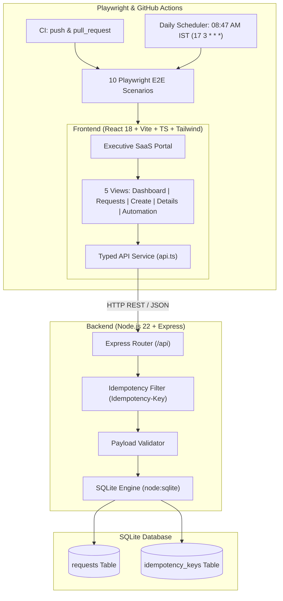

# Service Request Management Demo 🚀
### Enterprise Incident & Service Request Lifecycle Automation

[](https://github.com/menaka1703/service-request-automation-demo/actions/workflows/ci.yml)
[](https://github.com/menaka1703/service-request-automation-demo/actions/workflows/daily-regression.yml)

A modern, production-grade **Service Request Management SaaS Demo** built with React, Vite, TypeScript, Tailwind CSS, Express, SQLite, Playwright end-to-end automation, and GitHub Actions CI/CD scheduling.

Designed specifically for executive and technical management demonstrations, featuring enterprise UI/UX polish, idempotency-protected ticket submissions, deterministic database state management, and an automated regression test suite.

---

## 🌟 Key Highlights & Features

- **Modern Enterprise SaaS UI**: Clean dark-mode sidebar, responsive header with breadcrumbs, executive metric cards, custom SVG analytics charts, and high-contrast status/priority badges.
- **Complete Ticket Lifecycle CRUD**:
  - Auto-generated formatted IDs (`REQ-YYYY-NNN`).
  - Strict validation on creation and inline mutation.
  - Quick status transition dropdowns and detail transition buttons (`Open` → `In Progress` → `Completed` → `Closed`).
  - Search across IDs, titles, and descriptions with debounced query execution.
  - Multi-attribute filtering (Status, Urgency Priority, Service Category) with instant filter reset.
  - Deterministic server-side pagination with boundaries.
  - Destructive confirmation modals and non-blocking toast notifications.
- **Duplicate Submission Guard**: Native `Idempotency-Key` header support with server-side response caching to prevent accidental double-clicks or repeated network submissions.
- **Zero-Dependency SQLite Persistence**: High-performance local persistence using Node.js 22 native `node:sqlite` engine with automated migrations, schema indexing, and sample dataset seeding.
- **Playwright Test Matrix**: 10 comprehensive end-to-end scenarios running against an isolated test database with HTML reporting, screenshots, and video traces on failure.
- **GitHub Actions Automation**:
  - **CI Workflow (`ci.yml`)**: Automated builds and test validation on every push and pull request.
  - **Daily Regression Scheduler (`daily-regression.yml`)**: Scheduled daily at **08:47 AM IST** (03:17 UTC) via cron with manual `workflow_dispatch` support, test database isolation, and failure artifact retention.

---

## 🏛️ System Architecture



---

## 💻 Tech Stack

| Layer | Technology | Description |
| :--- | :--- | :--- |
| **Frontend** | React 18, TypeScript, Vite | Fast HMR, type safety, modular component hierarchy |
| **Styling** | Tailwind CSS 3, Lucide Icons | Responsive enterprise styling, polished animations |
| **Backend** | Node.js 22, Express | RESTful API, structured error handling, CORS enabled |
| **Database** | SQLite (`node:sqlite`) | Zero-configuration ACID engine, indexed schema |
| **Testing** | Playwright Test Suite | 10 end-to-end scenarios with HTML reports & traces |
| **CI/CD** | GitHub Actions | Automated regression, failure artifact uploads, daily scheduler |

---

## 🚀 Getting Started

### Prerequisites

- **Node.js**: v22.0.0 or higher
- **npm**: v10.0.0 or higher
- **Git**

### Installation

1. Clone or open the project directory:
   ```bash
   cd service-request-automation-demo
   ```

2. Install dependencies:
   ```bash
   npm install
   ```

3. Install Playwright Chromium browser:
   ```bash
   npx playwright install chromium
   ```

4. Seed the initial demo database:
   ```bash
   npm run seed
   ```

---

## 🛠️ Running the Application

### Development Mode (Full-Stack)
Runs both the backend API (`http://localhost:5000`) and the Vite frontend (`http://localhost:3000`) concurrently:
```bash
npm run dev
```

### Run Server Individually
```bash
npm run dev:server
# or in production:
npm start
```

### Run Client Individually
```bash
npm run dev:client
```

### Production Build
Verifies TypeScript typings and compiles optimized production assets into `dist/`:
```bash
npm run build
```

---

## 🧪 Playwright End-to-End Automation

The regression suite validates 10 key operational scenarios:

| Scenario | Spec File | Coverage Description |
| :---: | :--- | :--- |
| **01** | `01-create-request.spec.ts` | Form input, category/priority selection, ID generation, redirect to details |
| **02** | `02-view-request.spec.ts` | Inspection of ticket details, metadata display, and navigation return |
| **03** | `03-edit-request.spec.ts` | In-place editing, title/description updates, and mutation persistence |
| **04** | `04-delete-request.spec.ts` | Confirmation modal dialog, database deletion, and UI table synchronization |
| **05** | `05-validation.spec.ts` | Required-field enforcement, minimum character lengths, inline error cues |
| **06** | `06-search-filters.spec.ts` | Debounced title/ID search, multi-filter dropdown combinations, filter reset |
| **07** | `07-pagination.spec.ts` | Page boundary navigation, item count labels, previous/next states |
| **08** | `08-status-update.spec.ts` | Detail transition buttons and table quick-status dropdown updates |
| **09** | `09-duplicate-submission.spec.ts` | Idempotency-Key validation, cached replay response, duplicate prevention |
| **10** | `10-api-db-persistence.spec.ts` | Direct REST API verification (`POST`, `GET`, `PUT`, `PATCH`, `DELETE`) |

### Execute Tests

Run the full suite in headless mode:
```bash
npm run test:e2e
```

Run tests with a visual browser window:
```bash
npm run test:e2e:headed
```

Open the interactive Playwright UI Runner:
```bash
npm run test:e2e:ui
```

View the generated HTML report:
```bash
npm run test:e2e:report
```

---

## 📊 Consolidated Daily Test Report

A core enterprise capability of this demo is the automated generation of an audited, downloadable **Consolidated Daily Test Report** (`daily-report.html` and `daily-report.json`) generated on every regression run.

### Report Sections & Audit Standards

1. **Execution Environment**:
   - Environment (Local / CI runner).
   - Exact application build tested (`v1.0.0-rc1-verified`).
   - Git commit SHA and branch (clearly identifies tested build; never assumes latest deployed).
   - Execution date/time with local timezone (`Asia/Kolkata` IST).
   - OS, Node.js (`v22`), npm (`v10`), Playwright (`v1.50`), and Chromium versions.
   - Database configuration (`SQLite node:sqlite` isolated test DB).

2. **Results by Hub**:
   Multi-hub operational reporting across:
   - **Property Management Hub**
   - **Onboarding Hub**
   - **Portal 360 Hub**
   - For every hub, displays **Passed, Failed, Flaky, Skipped, Blocked, Not Run**, Total Tests, and Duration.
   - *Strict Audit Standard*: Zero failures are never confused with unexecuted tests. Unexecuted tests are explicitly recorded as **Not Run**; environmental dependencies are recorded as **Blocked**.

3. **Business Workflow Coverage**:
   - Maps 11 enterprise business workflows across hubs.
   - Categorized as **Covered**, **Partially Covered**, or **Not Covered**.
   - Explicitly highlights **Manual Testing Gaps** (e.g. physical asset barcode scans, external vendor API stubs).

4. **Code Changes & Contributor Attribution**:
   - Lists modified files and commit SHAs since previous baseline.
   - *Non-Causation Rule*: Emphasizes that contributor attribution identifies who touched code, but is **never treated as proof of failure causation**. Only confirmed investigation establishes root cause.

5. **New & Continuing Failures & Root Cause**:
   - Test ID, hub, workflow, severity, error summaries, and log evidence links.
   - Displays **"Root cause: Not confirmed"** unless root cause is verified through investigation.
   - Interactive toggle demonstrates an educational investigation case study comparing contributor attribution with confirmed root cause.

6. **Fix Commits & Independent Retest History**:
   - Fix commit SHA and tested retest build ID.
   - Strictly distinguishes the **Fix Author** from the **Independent Verifier** (peer review standard).

7. **Pending Decisions, Integrations & Next Actions**:
   - Tracks blockers, missing credentials (e.g. vendor maintenance mock API, Okta SCIM sync token), owners, and due dates.

### Generate & Download Reports Locally

```bash
# Generate report from latest test execution
npm run report:generate

# Run full Playwright test suite and automatically generate report
npm run test:e2e:full
```

Generated report artifacts:
- Standalone HTML: [`daily-report.html`](daily-report.html) (print-ready, responsive)
- Machine-readable JSON: [`daily-report.json`](daily-report.json)
- Immutable archive: `reports/daily-report-<timestamp>.html`
- In UI: Navigate to **Test Reports** tab in the sidebar to inspect or download.

---

## 🗄️ Backend REST APIs

| Method | Endpoint | Description |
| :--- | :--- | :--- |
| `GET` | `/api/requests` | List requests (supports `search`, `status`, `priority`, `category`, `page`, `limit`) |
| `GET` | `/api/requests/:id` | Retrieve single ticket by ID |
| `POST` | `/api/requests` | Create request (supports `Idempotency-Key` header) |
| `PUT` | `/api/requests/:id` | Full update of title, description, category, priority, status |
| `PATCH`| `/api/requests/:id/status` | Fast status transition |
| `DELETE`| `/api/requests/:id` | Delete request |
| `GET` | `/api/requests/stats` | Aggregate metrics for dashboard charts & cards |
| `POST` | `/api/reset` | Reset and re-seed database with clean demo records |
| `GET` | `/api/health` | Health check endpoint |

---

## ⏰ Daily Automation Scheduler

The scheduled workflow is configured in [`.github/workflows/daily-regression.yml`](.github/workflows/daily-regression.yml):

- **Cron Schedule**: `17 3 * * *`
  - IST is UTC+5:30.
  - `03:17 UTC` translates exactly to **08:47 AM IST**.
- **Manual Trigger**: Supports `workflow_dispatch` from the GitHub Actions tab.
- **Isolated Testing**: Deletes any preexisting test database and seeds fresh data before running Playwright.
- **Artifacts**: Uploads HTML and JSON test reports with a 30-day retention policy. Screenshots and failure traces are captured on error.
- **Job Summary**: Renders an executive PASS/FAIL summary table directly in `$GITHUB_STEP_SUMMARY`.

---

## 📦 GitHub Repository Setup

To link and push this project under your personal GitHub account (`menaka1703`):

1. Initialize Git (if not already initialized):
   ```bash
   git init
   git branch -M main
   ```

2. Add all files:
   ```bash
   git add .
   ```

3. Create the initial commit:
   ```bash
   git commit -m "feat: complete service request management demo with Playwright e2e and GitHub Actions"
   ```

4. Create the remote repository on GitHub:
   - Navigate to [https://github.com/new](https://github.com/new)
   - Repository name: `service-request-automation-demo`
   - Owner: `menaka1703`
   - Visibility: Public or Private

5. Link the remote and push:
   ```bash
   git remote add origin https://github.com/menaka1703/service-request-automation-demo.git
   git push -u origin main
   ```

*(Note: Per project guidelines, no automatic commits or remote pushes are executed without explicit user permission).*

---

## 📄 License
MIT License. Created by [menaka1703](https://github.com/menaka1703).

